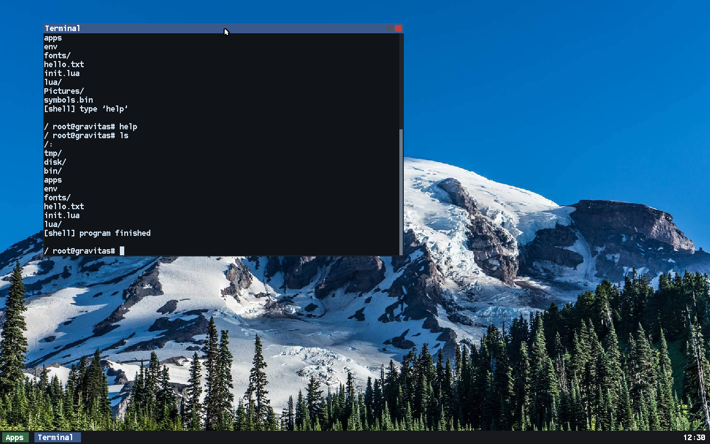
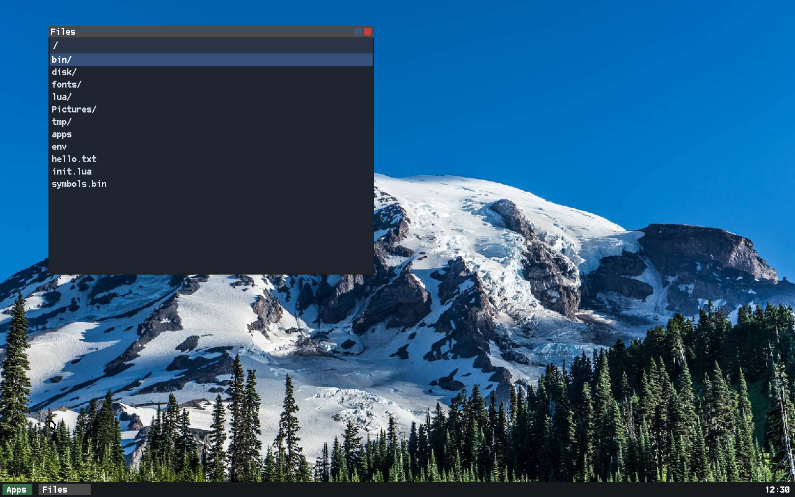
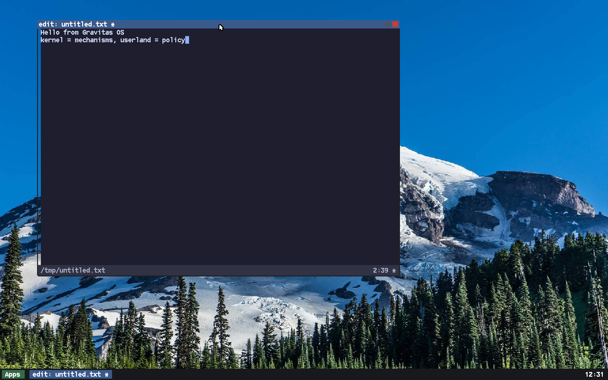
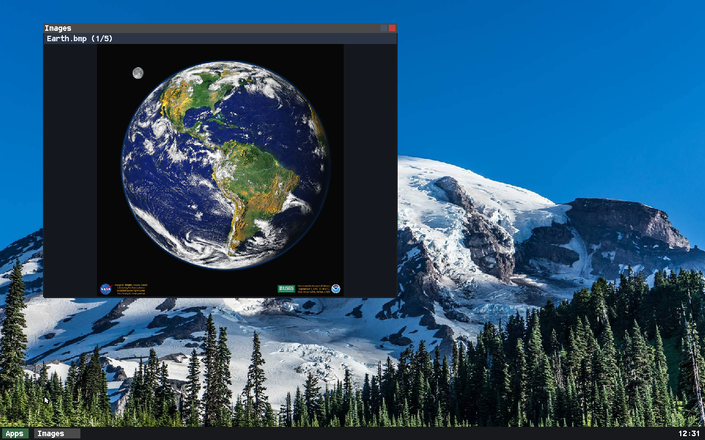
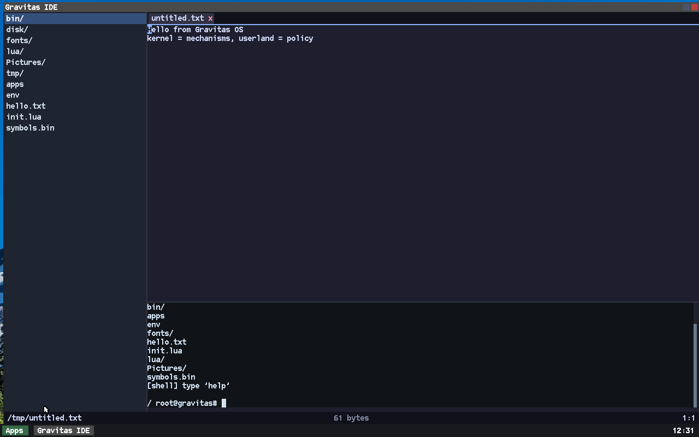
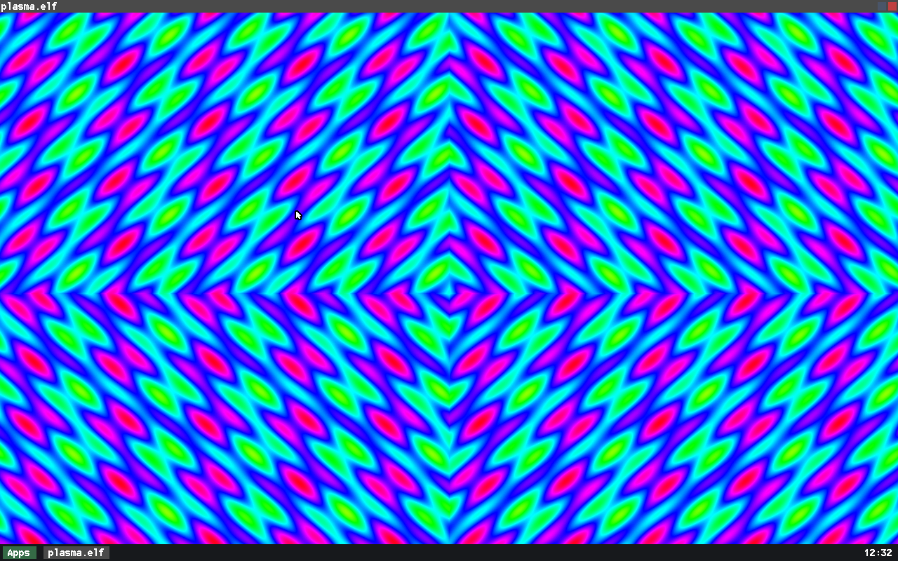

# Gravitas OS

An x86_64 hobby operating system. Limine boots a monolithic kernel; the
userland is ordinary programs linked against a small libc. The kernel owns
mechanisms, userland owns policy.


## What it is

Gravitas is a working desktop built from the ground up. The kernel starts
exactly one program, `/bin/init.elf`, which runs a Lua boot manifest that names
the shell, the window manager and the terminal. Because it is Lua, the manifest
can branch on how each one starts. Everything above the syscall boundary, from
the C library to the widget set to the window manager, is userland code in this
tree.

The whole design hangs on one rule: **the kernel owns mechanisms; userland owns
policy**. The kernel knows tasks, memory, a writable filesystem, four-word
mailboxes, and a "surface", a w×h pixel buffer with an owner and a z-order. It
does not know the word *window*. Above the line, userland decides what a
message `type` means, how windows are decorated, what runs at boot, and what the
shell grammar is, all in code you can read and change.

## Highlights

### Boot and init
- Limine loads three things: the kernel, a `files.tar` userland image, and an
  ext2 `disk.img`.
- The kernel starts one program, `/bin/init.elf`, and idles. `init.elf` runs a
  Lua manifest (`files/init.lua`) that spawns the shell, then the WM, then the
  terminal.
- `/` is writable: the tar image is the read-only lower layer, and the `root`
  directory on `disk.img` is the upper layer, so a file written at runtime
  copies up into ext2 and survives a reboot. Without a disk the upper is a
  ramfs and the changes last only for the session.

### Filesystem and storage
- `/` is an **overlay**: a read-only tarfs lower layer over a writable upper,
  with copy-up on write and `.wh.<name>` whiteouts on delete. The upper is the
  `root` directory on the data disk when one is present, so writes at `/`,
  `/home` and the rest survive a reboot; `/tmp` is a separate ramfs (volatile,
  1 MB per file). Without a disk the upper is a ramfs too.
- A node-shaped VFS with `ino`/type/size/mode/mtime, so `ls -l` works and
  `opendir`/`readdir` report real `d_ino`/`d_type`.
- Read-write ext2 mounted at `/disk`, driven over ATA PIO or virtio-blk (DMA on
  PCI, split virtqueue, a 16 KB direct-map staging buffer). The writer allocates
  and frees blocks and inodes, and `sync`/`fsync` write dirty pages back before
  flushing the drive's write cache.
- A 64-page (256 KiB) write-back page cache (`BlockCache`) between ext2 and the
  block layer: a 1 KB block read fetches one 4 KB page and its neighbours become
  hits, while `Block` itself stays a cacheless sector contract.
- The `Block::Device` contract is: a name, a size, and read/write of a 512-byte
  sector run, so a filesystem does not care where its bytes come from.

### Processes, IPC and memory
- Round-robin preemptive scheduling at 50 Hz. Each task owns its CR3, a kernel
  stack with a canary, an FPU/SSE save area, its `brk`, its working directory
  and its fd table.
- Mailboxes carry four words `{from, type, a, b}`. The kernel moves them
  verbatim and stamps the true sender, so userland cannot spoof it.
- Zero-copy shared-memory file mappings (`MAP_FILE`/`MUNMAP`, read-only views of
  immutable tarfs members) and refcounted shared regions
  (`SHM_CREATE`/`GRANT`/`MAP`/`CLOSE`).
- 63 syscalls through `int $0x80` (numbers 0 to 64; two retired entries return
  `-ENOSYS`), dispatched from a number→handler table.
- A fault dumps the registers and a symbolised `RIP=0x... (main(int,
  char**)+0x2C)` from a build-time symbol table (`tools/mksyms.py`, about 6000
  functions). A user-mode fault kills the task and the system carries on; a
  kernel-mode fault halts.

### Graphics, desktop and input
- A **surface** is the only graphics primitive. `present()` repaints only the
  damaged rectangles; `SURFACE_COMMIT` carries a rect, so a partial redraw is a
  partial repaint.
- A userland window manager (`wm.elf`): decorations, taskbar, launcher, Alt+Tab,
  and cooperative close. An app can veto a close via `on_close`, and one that
  ignores the request is force-killed after about 1.5 s.
- Resizable windows via a `SURFACE_RESIZE` handshake (`GRV_WM_RESIZE` /
  `GRV_WM_RESIZED`): the client owns its pixels, so the WM asks and the client
  answers the size it took.
- Clipboard is a file, `/tmp/.clipboard`, used with Ctrl+Shift+C/V.
- The userland terminal hosts a real shell in a window via
  `CONSOLE_ATTACH`/`READ`/`WRITE`; the kernel never learns what a terminal is.

### libc, language and shell
- A from-scratch C library covering the C functions Lua 5.4.9 needs (about 90
  symbols): string/ctype, `FILE*` stdio with `printf`, `malloc` over `brk`, libm,
  `setjmp`, time.
- A deliberately partial POSIX facade (`unistd`, `stat`, `dirent`, `fcntl`):
  ownership and link counts are not modelled, so those fields read zero.
- A working Lua 5.4.9 port (`lua.elf`, REPL and scripts); modules are found via
  `LUA_PATH` from the environment file `/env`.
- A shell with `cmd < in`, `> out`, `>> out` and `a | b | c`, builtins
  (`cd`, `pwd`, `bg`, `run`, `kill`, `jobs`, `help`), history and line editing.
  Ctrl+C interrupts the foreground job (exit 130).
- One ELF per program, statically linked, no `dlopen`.

### Tooling and quality
- `ninja check` runs host tests in about two seconds with no QEMU.
- `ninja test` boots the guest groups; `ninja soak` boots 40 times looking for a
  hang (40 boots catch a one-in-fifteen hang about 94% of the time).
- A host test (`tools/check_syscalls.py`) asserts the syscall header, the kernel
  dispatcher and `docs/syscalls.md` all agree.
- The soak found a roughly one-in-fifteen boot hang: the PIC was being
  reprogrammed with interrupts enabled. A longer run (`tests/soak.py -n 240`)
  then proved the fix over 336 consecutive clean boots.

## App gallery

All of these are ordinary programs under `src/user/`.

| Terminal | Files | Text editor |
|---|---|---|
|  |  |  |
| hosts a real shell in a window | a file browser over the overlay | selection, undo, clipboard |
| Image viewer | IDE | Plasma |
|  |  |  |
| decodes BMP from a zero-copy mapping | explorer, editor and terminal in one window | the classic plasma demo effect |

## Architecture

### The layer rule

| the kernel provides | userland decides |
|---|---|
| bytes on a disk, sectors, a mount table, files and fds | what a file *means*, what runs at boot, the shell grammar |
| a task, a scheduler, memory, a program break | which programs exist, what they do |
| a surface: a w×h pixel buffer with an owner, a position and a z-order | what a "window" is, how it is decorated, dragged and closed |
| four-word messages moved verbatim, with a kernel-stamped sender | what a message `type` means; the WM protocol |
| `int $0x80` and a fixed ABI | the C library, the widget set, every policy above |

The kernel does not inspect a `type` it did not post, and it does not know the
word "window". When behaviour moves, it moves across this line: the boot order
used to be hardcoded in `kmain`, and is now a Lua file that init runs.

### Boot path

```
Limine ──▶ kernel (kmain) ──▶ init.elf ──▶ /init.lua ──▶ shell / wm / term
```

`kmain` (`src/kernel/main.cpp`) brings up the C++ runtime, physical and virtual
memory, the CPU and interrupts, a block-layer self-test, the overlay root, the
read-write ext2 data disk, the console font and the symbol table, and then spawns
`/bin/init.elf`. If that fails, the one fallback is a console shell.

`init.elf` links in Lua and runs `/init.lua`. The shipped manifest starts
`shell.elf`, then `wm.elf`, then `term.elf`, in that order; the `init` table it
exposes (`spawn`, `run`, `wait`, `kill`, `sleep`, `cwd`, `log`) is documented at
the top of `files/init.lua`.

### `grv` versus `gravity`

The OS is named **Gravitas**. Its userland ABI is two namespaces with a strict
direction: `grv` is the contract, `gravity` is convenience built on it.

| | `<grv/...>` | `<gravity/...>` |
|---|---|---|
| what it is | the kernel ABI plus the conventions userland agrees on | the higher-level userland library |
| source | headers only, `src/libc/include/grv/` | headers + compiled code, `src/libc/gravity/` |
| contents | syscall numbers and wrappers, the input-event wire format, the WM protocol, the clipboard convention | a surface-backed canvas, an event loop, a widget set, and the shared font/image/text/editor/filer/term primitives |
| who uses it | the libc wrappers and any program that talks to the kernel directly | applications, via `<gravity/gravity.h>` |

There is no compiled `grv`: every header under `src/libc/include/grv/` is
declarations and `static inline` wrappers. `gravity` includes `grv`; `grv`
includes neither `gravity` nor any library code, only the ABI and the two
conventions above.

## Build requirements

The build targets Linux hosts. It is developed on Arch with clang/LLD 23, ninja
1.13 and QEMU 11; any recent clang toolchain should work.

Host tools, with the package that provides each on Arch as an example:

| tool | Arch package | needed for |
|---|---|---|
| `clang++`, `clang` | `clang` | compiling C++ and assembly |
| `ld.lld` | `lld` | linking |
| `xorriso` | `xorriso` | making the ISO |
| `tar` | `tar` | packing the image |
| `mke2fs` | `e2fsprogs` | making the ext2 test image |
| `ninja` | `ninja` | running the build |
| `python3` | `python` | configure.py, the build helpers, the tests |
| `qemu-system-x86_64` | `qemu-system-x86` | running and testing (not needed to build) |

Other distributions ship the same tools under their own package names, so check
for the executable rather than the package name (Debian and Ubuntu call `ninja`
`ninja-build`, for instance).

Needed only on the first configure, because Limine and Lua are fetched then:
`git`, `make`, `curl`.

`configure.py` checks all of the above and stops with a message if something is
missing.

## Build and run

```sh
python3 configure.py
ninja               # the kernel ELF only; userland comes with ninja iso
ninja iso           # gravitas.iso
ninja run           # build and boot it in QEMU
```

`ninja` alone builds just `bin/gravitas.elf`; `ninja iso` builds every userland
ELF as well and packs the image. `ninja run` boots `gravitas.iso` under QEMU
with SeaBIOS (BIOS), and the same ISO is hybrid, so it boots under UEFI too. On
first boot the desktop comes up with a taskbar: click the **Apps** button on the
left to open the launcher. Close the QEMU window (or run `poweroff` in the guest
shell) to quit.

## Test

```sh
ninja check         # host tests, a couple of seconds, no QEMU
ninja test          # host tests plus the guest groups
ninja test-kernel   # guest groups only
ninja test-ui       # the window/desktop groups only
ninja soak          # boot the machine 40 times, checking for a boot hang
```

`ninja check` runs the libc pieces that build and run natively plus
`tools/check_syscalls.py`, which checks the syscall ABI against its
documentation. The guest groups are documented in
[`tests/README.md`](tests/README.md).

## Layout

| path | what it is |
|---|---|
| `src/kernel/` | the kernel: `core/` (PMM, VMM, heap, sched, IPC, timer, fault), `dev/` (ATA, virtio, ext2, keyboard, mouse, RTC, RAM disk, modules), `gfx/` (framebuffer, console, compositor, font) |
| `src/arch/x86_64/` | GDT, IDT + the syscall dispatcher, PIC/IOAPIC, context-switch and user-mode assembly, the linker script |
| `src/fs/` | VFS, ramfs, tarfs, the overlay, and the ELF loader |
| `src/libc/` | the C library, the POSIX facade, and the `gravity` library; `include/grv/` is the ABI surface |
| `src/user/` | userland programs (one `.cpp` per program) |
| `files/` | what is packed into the image root: `apps`, `init.lua`, `env`, `fonts/`, `Pictures/`, `lua/` |
| `tools/` | host-side build helpers |
| [`docs/architecture.md`](docs/architecture.md) | how the OS is put together: the boot path and the major subsystems |
| [`docs/adding-an-app.md`](docs/adding-an-app.md) | a new program: one `.cpp` and a line in `files/apps` |
| [`docs/syscalls.md`](docs/syscalls.md) | the syscall ABI and the mechanisms below it |
| [`tests/`](tests/) | the test suite; see [`tests/README.md`](tests/README.md) |

## Status

The desktop, the Lua port, the shell, the IDE, the writable overlay and the test
suite are all in the tree and green. The kernel and userland grew together, each
subsystem landing with its own tests.

Not done yet:

- **`fork`/`exec`/`waitpid` and copy-on-write.** Spawn/exit/wait exist; the POSIX
  process model does not.
- **Threads and TLS.** Everything is single-threaded and `errno` is a global.
- **`poll`/`select`.** The mailbox model covers Lua's single `recv` loop.
- **SMP.** The system is idle- and I/O-bound; this is the largest rewrite
  available.
- **CI.** There is no GitHub Actions job yet. `ninja check` needs no QEMU and
  takes about two seconds, so it could run in one today; the guest suite still
  has to be run locally.
- **`panic()`.** A kernel-mode fault already dumps registers and a symbolised
  `RIP` and halts; what is missing is a call-stack trace (there is no unwinder)
  and a `panic()` entry point.
- **Real-hardware coverage.** QEMU is the target; there is no ACPI, AHCI, USB HID
  or GPU modesetting work yet.

## Third-party notices

Gravitas' own code is BSD 3-Clause (below). The built image also bundles:

- **Limine.** The bootloader, fetched by `configure.py` and pinned to the
  `v8.x-binary` branch. Its binaries are BSD 2-Clause; the checked-in
  `src/limine.h` is 0BSD.
- **Lua 5.4.9.** MIT licensed, fetched by `configure.py` and compiled into
  `bin/lua.elf` and `bin/init.elf`.
- **Bizcat.** The console font, CC licensed (share and adapt).
- **Pictures.** Wallpapers under `files/Pictures/`, not committed to the repo.

## License

Gravitas OS is released under the **BSD 3-Clause License**. See `LICENSE`.
